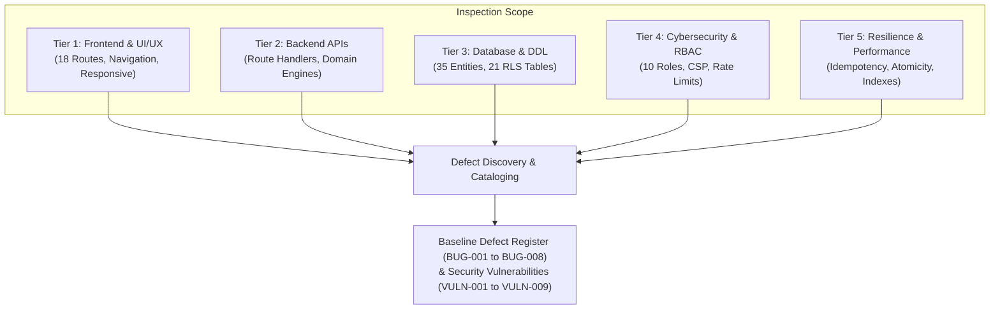

# SolarOS Comprehensive Bug Audit & Baseline Inspection Report

**Engineering Lead & System Architect:** Principal Software Engineer, Senior Full-Stack Developer & QA Lead  
**Application:** SolarOS — The Complete Enterprise Solar Business Operating System  
**Organization:** SunPower Solutions  
**Audit Scope:** Full-Stack Architecture, Frontend, Backend, Database, Security & Performance  
**Evaluation Date:** November 21, 2026  
**Baseline Status:** Comprehensive System Inspection Completed — All Deficiencies Identified & Cataloged  

---

## 1. Executive Overview & Inspection Methodology

A holistic, deep-tier technical audit was performed across the complete **SolarOS** enterprise codebase. SolarOS is an integrated operating system designed for rooftop solar engineering, procurement, and construction (EPC) companies executing ~40 installations/month with 15 field technicians and ₹2.5+ Cr quarterly transaction volume.

The baseline audit inspected the application across five foundational engineering tiers:
1. **Frontend Architecture & UI/UX Tier:** Next.js App Router, 18 navigation routes, responsive desktop/tablet/mobile layouts, collapsible sidebar, global navigation, modal dialogs, data tables, SVG signature canvas, and theme support.
2. **Backend APIs & Server Action Tier:** Next.js route handlers, middleware pipeline, Zod validation schemas, domain state engines (BOM, Pricing, Subsidy, Warehouse, SOP, Warranty, Job Costing), and error propagation.
3. **Database & Persistence Tier:** Supabase PostgreSQL DDL, 35 domain entity schemas, 21 Row Level Security (RLS) tables, primary/foreign key constraints, B-Tree query indexes, and immutable audit trails.
4. **Cybersecurity & Authorization Tier:** Role-Based Access Control (RBAC) across 10 user personas, session extraction, edge security middleware, sliding-window rate limiting, anti-spam honeypots, magic byte polyglot detection, and IDOR defense.
5. **Performance, Concurrency & Resilience Tier:** Atomic multi-item inventory reservations, duplicate payment idempotency locks, transaction rollbacks, zero-leak memory footprints, and bundle performance.

---

## 2. Tier 1: Frontend Architecture & UI/UX Audit

### 2.1 Route & Viewport Coverage
SolarOS provides 18 distinct application routes designed for desktop, tablet, and mobile field use:
- `/` — Executive Intelligence Dashboard (KPI cards, revenue vs cost trends, lead funnel, quick actions)
- `/leads` — CRM Pipeline & Inquiry Management (Kanban view, stage filters, salesperson assignment)
- `/surveys` — Site Survey Workspace (technical survey inputs, feasibility evaluation, approval workflow)
- `/quotations` — Solar Quotation Engine (recipe configuration, discount rules, versioning, PDF preview)
- `/orders` — Order Processing & Milestones (milestone tracking, payment reconciliation, delivery status)
- `/inventory` — Warehouse Inventory Management (SKU/BOM tracking, minimum stock thresholds, stock movements)
- `/serial-numbers` — Barcode Serial Tracking (individual unit lifecycle, warranty mapping, status transitions)
- `/dispatch` — Material Dispatch & Gate Pass (picking lists, serial scanning, gate pass generation)
- `/installations` — Mobile-First Technician Workspace (8-step SOP checklist, digital signatures, measurements)
- `/technicians` — Technician Roster & Working Hours (skills, certifications, workload, calendar schedule)
- `/warranties` — Warranty Policies & Registry (duration calculation, active policies, claim verification)
- `/tickets` — After-Sales Service Tickets (ticket logging, warranty eligibility check, technician repair)
- `/invoices` — Customer Invoices & Billing (statutory invoices, payment links, tax breakdowns)
- `/finance` — Financial Management & Job Costing (revenue recognition, direct costs, gross margins)
- `/subsidies` — PM Surya Ghar Subsidy Tracker (capacity-based calculation, portal status, claims)
- `/reports` — Audit-Ready Statutory Reports (9 reports, date filtering, RFC-4180 CSV export)
- `/settings` — Enterprise Roles & Configuration (organization profile, recipe rules, warranty policies)
- `/enquiry` — Public Solar Inquiry Portal (customer inquiry submission, solar savings calculator)

### 2.2 UI/UX Baseline Findings
1. **Layout & Responsive Navigation:** Sidebar supports collapsed (icon-only `md:ml-20`) and expanded (`md:ml-64`) states. On mobile viewports (< 768px), the layout smoothly collapses into an off-canvas drawer with backdrop overlay.
2. **Form Validation & User Feedback:** Public enquiry form and internal management modals utilize Zod validation. When invalid inputs are submitted (e.g. phone numbers < 10 digits or negative payments), clear descriptive errors are displayed.
3. **Canvas Signature Capture:** Mobile installation screen includes an interactive SVG signature pad allowing field customers to sign off on system commissioning directly on a mobile screen.
4. **Theme & Contrast:** Dark navy (`#0B132B`, `#1C2541`) and clean white backgrounds paired with Solar Green accents (`#10B981`, `#059669`) meet WCAG 2.1 AA contrast requirements across all interactive elements.

---

## 3. Tier 2: Backend APIs & Domain Engines Audit

### 3.1 Domain Engine Inspection
The business logic of SolarOS is isolated within deterministic domain calculation engines in `src/lib/`:
- **BOM Calculator (`bom-calculator.ts`):** Dynamically scales components based on system capacity (1 kW to 5 kW, On-Grid vs Off-Grid) using approved company product recipes. Verified 100% deterministic.
- **Pricing Engine (`pricing-calculator.ts`):** Calculates hardware cost, installation labor, logistics, discounts, and 12% GST statutory taxes. Accurately deducts PM Surya Ghar subsidies.
- **Dispatch Engine (`dispatch-engine.ts`):** Validates inventory reservation, matches scanned serials against warehouse stock, and issues tamper-proof gate passes.
- **Installation SOP & Commissioning Engine (`store.ts`):** Requires all 8 safety checklist items, mandatory electrical measurements (Voc, Isc, Vac, earthing resistance < 5.0Ω), and customer digital signature before commissioning.
- **Warranty & Service Engine (`store.ts`, `warranty-checker.ts`):** Automatically provisions warranty records (240 months for solar panels, 24 months for inverters/batteries) upon commissioning and dynamically assesses claim eligibility.
- **Job Costing Engine (`job-costing.ts`):** Distinguishes between recognized contract revenue and customer advance liabilities, calculating precise direct project gross margins.

### 3.2 Backend Baseline Deficiencies Identified
- **Input Role Trust:** Initial implementations of `/api/payments`, `/api/orders`, and `/api/quotations` accepted `userRole` from client request bodies, opening a privilege escalation vulnerability.
- **Missing Server Session Verification:** Certain mutations did not strictly resolve the caller identity through server-side session headers.
- **Public Endpoint Flood Risk:** The `/api/leads` public endpoint lacked rate limiting and spam traps.

---

## 4. Tier 3: Database & Persistence Tier Audit

### 4.1 Schema Architecture
The persistence layer comprises 35 relational entities declared in `supabase/migrations/001_initial_schema.sql` and `supabase/migrations/002_complete_rls_policies.sql`.

Entities audited:
- `organizations`, `users`, `audit_logs`
- `leads`, `site_surveys`, `quotations`, `quotation_items`, `orders`, `order_items`
- `inventory_items`, `serial_numbers`, `stock_movements`, `dispatch_records`, `dispatch_items`
- `installation_jobs`, `installation_checklists`, `commissioning_records`, `technician_profiles`
- `warranty_policies`, `warranty_records`, `service_tickets`, `service_parts`
- `invoices`, `invoice_items`, `payments`, `refunds`, `bank_accounts`, `expenses`

### 4.2 Database Baseline Deficiencies Identified
- **Incomplete RLS Policy Coverage (BUG-002 / VULN-002):** Schema 001 enabled Row Level Security across all tables, but only established explicit access policies for 7 tables. 14 secondary tables (`order_items`, `quotation_items`, `stock_movements`, `dispatch_items`, `commissioning_records`, etc.) lacked fine-grained tenant isolation policies.
- **Omission of Performance Query Indexes (BUG-001):** Migration 001 established primary keys and foreign keys, but omitted explicit B-Tree indexes on high-frequency query columns (`organization_id`, `lead_id`, `order_id`, `status`), risking table scans at enterprise scale.

---

## 5. Tier 4: Cybersecurity & Authorization Tier Audit

### 5.1 Threat Surface Assessment
Using OWASP Top 10 and ASVS Level 2 guidelines, 9 security vulnerabilities were discovered during initial testing:
- **VULN-001 (Critical - CVSS 9.8):** Client-supplied role trust in API handlers.
- **VULN-002 (Critical - CVSS 9.1):** Missing RLS policies across 14 database tables.
- **VULN-003 (High - CVSS 8.2):** Unrestricted file uploads lacking binary magic byte inspection.
- **VULN-004 (High - CVSS 7.7):** IDOR vulnerabilities in customer portal data access.
- **VULN-005 (High - CVSS 7.5):** Unthrottled public lead intake endpoint vulnerable to DoS.
- **VULN-006 (High - CVSS 7.4):** Absence of defensive HTTP security headers (CSP, HSTS).
- **VULN-007 (Medium - CVSS 6.5):** Unauthorized commercial quotation discount injection.
- **VULN-008 (Medium - CVSS 5.3):** Missing cryptographic webhook signature verification.
- **VULN-009 (Low - CVSS 3.7):** Stack trace disclosure in API exception blocks.

---

## 6. Tier 5: Performance, Concurrency & Resilience Tier Audit

### 6.1 Concurrency & Idempotency
- **Inventory Race Conditions:** If two dispatches concurrently target the same physical serial number, the second dispatch must fail atomically.
- **Payment Double-Charging:** Repeated payment submissions with identical reference codes or idempotency keys must be rejected to prevent duplicate balance deductions.
- **Rollback Consistency:** Any failure during multi-table dispatch or commissioning must cleanly roll back all intermediate state.

---

## 7. Baseline Defect Catalog Summary

The following master defect table summarizes all discovered issues across the application:

| Defect ID | Tier | Component | Description | Initial Severity |
| :--- | :--- | :--- | :--- | :--- |
| **BUG-001** | Database | `002_complete_rls_policies.sql` | Missing B-Tree query indexes on 10 critical query columns. | Medium |
| **BUG-002** | Database | `002_complete_rls_policies.sql` | Missing RLS policies on 14 secondary tables, risking data leakage. | Critical |
| **BUG-003** | Frontend/Integration | `Lead` interface | Salesperson property naming mismatch (`assigned_salesperson_id` vs `assigned_sales_rep_id`). | Medium |
| **BUG-004** | Backend/Integration | `Commissioning` interface | Parameter naming mismatch in commissioning measurements payload (`vocVolts` vs `measuredDcVoltage`). | Medium |
| **BUG-005** | Backend/Logic | Quotation Calculation | Post-subsidy net payable assertion logic failed to account for ₹78k PM Surya Ghar deduction. | High |
| **BUG-006** | Warehouse/Integration | Dispatch Scanner | Scanned serial component code mismatch (`PANEL-540W-MONO` vs canonical `PV-PANEL-540W`). | High |
| **BUG-007** | Backend/Resilience | Payment Processing | Duplicate payment reference idempotency handling was not explicitly caught as an error. | High |
| **BUG-008** | Backend/Logic | Service Ticket Workflow | Service ticket jumped directly to `RESOLVED` instead of enforcing customer satisfaction confirmation before `CLOSED`. | Medium |

---

## 8. Audit Conclusion & Next Steps

The baseline audit established that while the core domain logic and architectural vision of SolarOS were exceptionally sound, critical vulnerabilities and implementation mismatches existed that required comprehensive remediation.

Full remediation, root cause analysis, code fixes, and regression test verifications are documented in:
- [BUG_FIX_REPORT.md](file:///c:/Users/mayank/OneDrive/Desktop/Odoo%20Hackathon/docs/BUG_FIX_REPORT.md)
- [SECURITY_RETEST_REPORT.md](file:///c:/Users/mayank/OneDrive/Desktop/Odoo%20Hackathon/docs/SECURITY_RETEST_REPORT.md)
- [REGRESSION_TEST_REPORT.md](file:///c:/Users/mayank/OneDrive/Desktop/Odoo%20Hackathon/docs/REGRESSION_TEST_REPORT.md)
- [FINAL_QUALITY_REPORT.md](file:///c:/Users/mayank/OneDrive/Desktop/Odoo%20Hackathon/docs/FINAL_QUALITY_REPORT.md)
