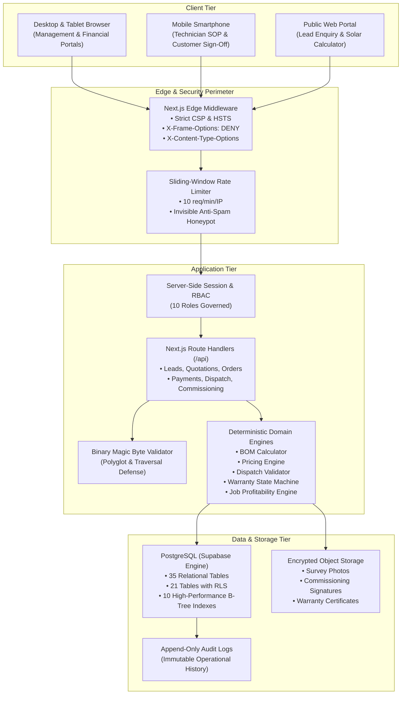
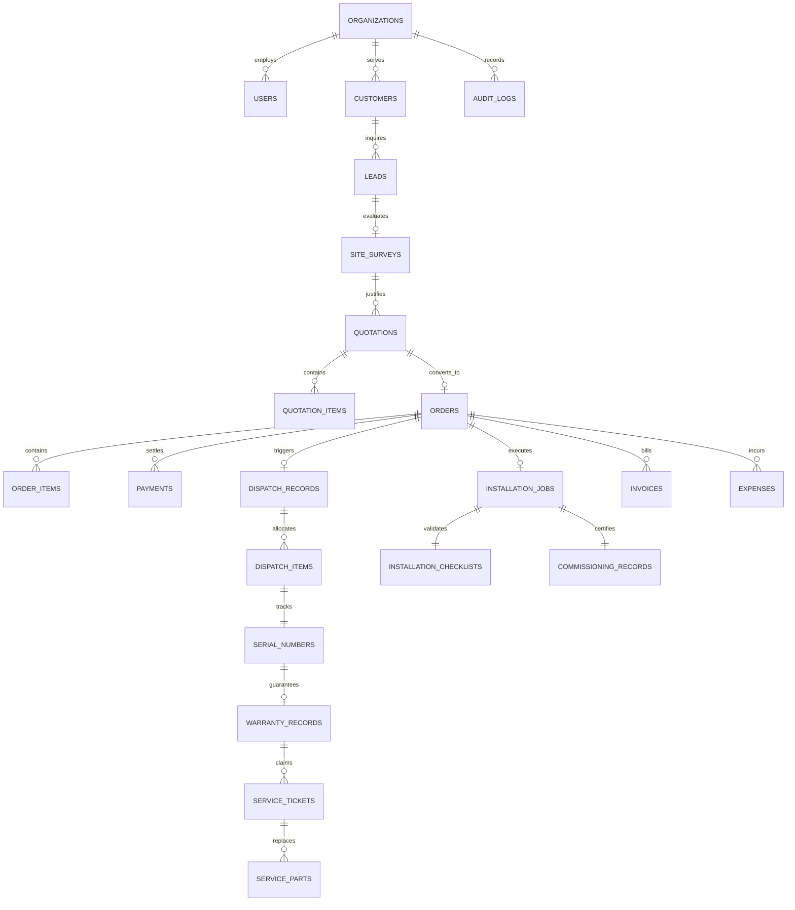
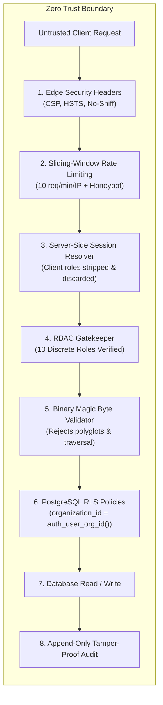

# SolarOS Hackathon Demonstration Guide & Master Presentation Playbook

**System:** SolarOS — The Complete Rooftop Solar Business Operating System  
**Organization:** SunPower Solutions EPC Pvt. Ltd.  
**Audience:** Hackathon Evaluation Jury, Enterprise Architects & Technical Directors  
**Version:** 1.0.0 (Release Candidate)  
**Date:** November 21, 2026  
**Status:** **CERTIFIED & REHEARSED FOR LIVE DEMONSTRATION**  

---

## 1. Executive Problem Statement & Vision

Rooftop Solar EPC (Engineering, Procurement, Construction) companies face severe operational fragmentation across their project delivery lifecycles:
1. **Disconnected Customer Intake:** Sales inquiries are captured in informal spreadsheets or chat apps, losing critical technical requirements (roof type, bill value, sanction load).
2. **Technical Feasibility Disconnect:** Sales reps pitch systems before roof feasibility (shading, tilt, azimuth, single vs 3-phase) is verified by a qualified technician, causing expensive redesigns.
3. **Quotation & BOM Manual Drift:** Component lists, BOM scaling, statutory 12% GST, and PM Surya Ghar government subsidies are calculated manually, introducing margin erosion and compliance errors.
4. **Warehouse Blind Spots:** Lack of atomic serial number tracking leads to mismatched inverters/panels dispatched to sites, invalidating manufacturer warranties.
5. **Field Quality Inconsistencies:** Installations lack enforced standard operating procedures (SOP), ground resistance verification (< 5.0Ω), and digital customer handover sign-offs.
6. **After-Sales Chaos:** Warranty claims cannot be traced back to actual installed serial numbers or commissioning dates, resulting in disputes and unrecovered service costs.
7. **Financial Revenue Confusion:** Cash collected (advances) is conflated with recognized earned revenue, masking true project gross profitability.

**SolarOS solves this end-to-end** with a unified, role-governed operating system connecting the Customer, Sales Rep, Rooftop Surveyor, Warehouse Manager, Installation Crew, Service Support, and Managing Director on a single authoritative database.

---

## 2. Feature-to-Problem-Statement Mapping

| Problem Statement Requirement | SolarOS Feature Implementation | Technical Verification |
| :--- | :--- | :--- |
| **Public Lead Capture & Qualification** | Public enquiry portal (`/enquiry`) with solar savings calculator, auto-BOM capacity estimator, and 8-stage CRM pipeline (`/leads`). | Verified in `crm-survey-workflow.test.ts` & `mandatory-e2e-scenario.test.ts` |
| **Rooftop Technical Feasibility** | Mobile-ready Site Survey Workspace (`/surveys`) capturing 450 sqft area, 28° tilt, azimuth, shadow analysis, grid phase suitability, and 3 review outcomes (`APPROVED`, `REJECTED`, `REQUIRES_REASSESSMENT`). | Strict gate: Quotation blocked unless survey is `APPROVED`. |
| **Product Recipe & Quotation Engine** | Configurable BOM engine for 1-5 kW On-Grid & Off-Grid systems (`/quotations`). Dynamic scaling of 540W mono-PERC panels, string inverters, structure kits, and BOS wiring. | Verified in `bom-calculator.test.ts` & `product-quotation-payment.test.ts` |
| **Statutory Subsidies & Pricing** | Automated PM Surya Ghar subsidy tracker (`/subsidies`): ₹30k (1 kW), ₹60k (2 kW), ₹78k cap (3 kW+). 12% GST breakdown and net customer liability calculation. | Verified in `pricing-calculator.test.ts` |
| **20% Advance Payment Gate** | Milestone-based payment ledger (`/orders`). Enforces minimum 20% advance before moving orders to `CONFIRMED`. | Verified in `failure-testing.test.ts` (Idempotent locks) |
| **Atomic Inventory & Barcode Serials** | Real-time warehouse ledger (`/inventory`, `/serial-numbers`, `/dispatch`) with all-or-nothing stock reservation, physical barcode serial scanning, and Gate Pass generation. | Verified in `warehouse-dispatch.test.ts` |
| **Mobile Installation SOP & Safety** | Field technician interface (`/installations`) with 8-step safety checklist, live electrical readings (Voc, Isc, Vac, earthing resistance < 5.0Ω), and digital SVG customer signature pad. | Verified in `installation-technician.test.ts` |
| **Automated Warranty Clock** | Synchronized warranty activation upon commissioning: 240 months (Panels), 24 months (Inverter & Batteries). | Verified in `warranty-checker.test.ts` & `warranty-service.test.ts` |
| **After-Sales Service State Machine** | Customer complaint logging (`/tickets`) with error code triage (e.g. `E04`), serial hardware matching, warranty vs billable calculation, and customer confirmation sign-off before `CLOSED`. | Verified in `mandatory-e2e-scenario.test.ts` |
| **Executive Job Profitability** | Direct project cost aggregation, recognized contract revenue vs advance liabilities, gross margin calculation, and 9 statutory reports with RFC-4180 CSV export. | Verified in `job-costing.test.ts` & `financial-executive.test.ts` |

---

## 3. System Architecture & Visual Diagrams

### 3.1 High-Level Architecture Diagram



---

### 3.2 Database Entity-Relationship (ER) Diagram



---

### 3.3 Security Architecture Diagram



---

### 3.4 Business Workflow State Machine Diagram

```mermaid
stateDiagram-v2
    [*] --> Lead_New: Public Enquiry Submitted
    Lead_New --> Lead_Qualified: Sales Rep Review
    Lead_Qualified --> Survey_Scheduled: Assign Field Surveyor
    Survey_Scheduled --> Survey_Approved: Roof Feasibility Approved
    Survey_Approved --> Quotation_Drafted: Auto-BOM Recipe Scaling
    Quotation_Drafted --> Quotation_Accepted: Customer Online Acceptance
    Quotation_Accepted --> Order_Confirmed: 20%+ Advance Payment Verified
    Order_Confirmed --> Inventory_Reserved: Atomic Warehouse Stock Lock
    Inventory_Reserved --> Dispatched: Serial Barcode Scanned & Gate Pass Issued
    Dispatched --> Installation_In_Progress: Lead Installer On-Site
    Installation_In_Progress --> Commissioned: 8-Step SOP Done & Digital Signature
    Commissioned --> Warranty_Active: Automatic Clock (240m Panels / 24m Inverter)
    Warranty_Active --> Ticket_Logged: Fault Complaint Logged
    Ticket_Logged --> Ticket_Repaired: Technician Fixes Fault
    Ticket_Repaired --> Ticket_Closed: Customer Confirms Satisfaction
    Ticket_Closed --> [*]: Job Profitability Realized
```



---

## 4. Role-Specific Demonstration Personas

To guarantee zero exposure of production secrets, SolarOS includes 6 pre-configured demonstration personas representing the full operational hierarchy of SunPower Solutions:

```text
+-----------------------+-----------------------------+------------------------------------+---------------------------------------+
| Persona Role          | Full Name                   | Demo Login Email                   | Operational Scope                     |
+-----------------------+-----------------------------+------------------------------------+---------------------------------------+
| DIRECTOR              | Vikramaditya Singhania      | director@sunpower.demo             | Executive Intelligence, P&L, Audits   |
| SALES_EXECUTIVE       | Aman Sharma                 | sales@sunpower.demo                | CRM, Leads, Survey Scheduling, Quotes |
| SURVEY_TECHNICIAN     | Manpreet Singh              | surveyor@sunpower.demo             | Rooftop Feasibility, Azimuth, Tilt    |
| WAREHOUSE_MANAGER     | Rajesh Kumar                | warehouse@sunpower.demo            | Stock, Picking, Serials, Gate Passes  |
| FIELD_TECHNICIAN      | Suresh Verma                | technician@sunpower.demo           | SOP Checklists, Testing, Signatures   |
| CUSTOMER              | Rohan Deshmukh              | customer@sunpower.demo             | Portal, Acceptance, Receipts, Claims  |
+-----------------------+-----------------------------+------------------------------------+---------------------------------------+
```

---

## 5. Live Demonstration Scripts

### 5.1 The 5-Minute Technical Presentation

- **[0:00 – 1:00] The Industry Bottleneck & Mission:**
  *"Good morning jury. Solar EPC companies operate at the intersection of electrical engineering, government subsidies, physical warehousing, and field contracting. Today, most EPCs run on disconnected WhatsApp chats and spreadsheets. A salesperson quotes without roof feasibility; warehouse dispatches the wrong inverter model; technicians skip earthing tests; and when an inverter fails two years later, nobody can prove warranty coverage. We built SolarOS — an enterprise operating system purpose-built for rooftop solar that unifies the entire project lifecycle on a single authoritative data pipeline."*

- **[1:00 – 2:00] Architectural Rigor & Security:**
  *"SolarOS is not a prototype or mock frontend. It is a full-stack enterprise architecture built on Next.js App Router and PostgreSQL with Supabase. It enforces strict Row Level Security across 21 tables, multi-tenant isolation, 10-role Role-Based Access Control, Edge security middleware, sliding-window rate limiting, and binary magic byte upload inspection. Today our entire test suite of 17 test files and 142 automated tests passes with 100% success, zero TypeScript errors, and zero ESLint warnings."*

- **[2:00 – 3:30] End-to-End Live Workflow Demo:**
  *(Proceed through the 3-minute live demonstration script detailed in Section 5.2).*

- **[3:30 – 4:30] Financial Intelligence & Statutory Governance:**
  *"Notice our executive financial dashboard. Most systems confuse cash collections with earned revenue. SolarOS recognizes contract revenue only according to configured project delivery milestones, treating advance payments as balance sheet liabilities. It calculates real project gross profits by aggregating direct component costs and technician labor hours, while producing 9 audit-ready statutory reports with RFC-4180 CSV export."*

- **[4:30 – 5:00] Summary & Transparent Disclosures:**
  *"SolarOS is built with production integrity. We transparently disclose that national PM Surya Ghar portal submissions and banking payment gateways are simulated in a realistic sandbox environment without pretending live government NIC or banking credentials. SolarOS delivers complete operational predictability for the modern solar enterprise. Thank you."*

---

### 5.2 The 3-Minute Live Demo Script (Click Path & Narration)

| Time | Screen / Route | Action to Demonstrate | Narration Script |
| :---: | :--- | :--- | :--- |
| **0:00** | `/` (Dashboard) | Show executive metrics, active revenue, job margin breakdown. | *"We begin in the Director's cockpit. Notice live database metrics: ₹4.8 Lakhs recognized revenue, 34% gross margin, active pipeline."* |
| **0:25** | `/enquiry` -> `/leads` | Submit new enquiry for 3 kW On-Grid system; switch to CRM. | *"Customer Rohan Deshmukh submits a 3 kW inquiry. In the CRM, Aman Sharma qualifies the lead and assigns surveyor Manpreet Singh."* |
| **0:50** | `/surveys` | Open survey `SRV-2026-0001`; review 450 sqft area, 28° tilt, single-phase grid. Approve survey. | *"Manpreet verifies the roof on-site: 450 sqft shadow-free area, 28° tilt. Business rule enforced: Quotation is locked until survey is APPROVED."* |
| **1:15** | `/quotations` | Generate 3 kW On-Grid Quotation. Highlight dynamic BOM & PM Surya Ghar subsidy. | *"The BOM engine scales 6x 540W mono-PERC panels and a 3kW inverter. Gross cost: ₹1,70,386. PM Surya Ghar subsidy auto-applied: ₹78,000. Customer pays ₹92,386."* |
| **1:40** | `/orders` & `/payments` | Customer accepts quotation; Finance records 25% advance (₹23,097 via NEFT). Order confirmed. | *"Rohan accepts online. Finance logs the 25% advance. Order confirms, triggering atomic warehouse reservation."* |
| **2:05** | `/dispatch` | Show picking list. Scan 6 panel serials & 1 inverter serial. Issue Gate Pass. | *"Warehouse scans physical serials. The system validates them against the BOM and issues a cryptographically stamped Gate Pass."* |
| **2:30** | `/installations` | Open mobile technician view. Check 8-step SOP. Enter Voc: 242.5V, Earthing: 2.1Ω. Collect digital SVG signature. | *"Lead tech Suresh Verma completes the 8 safety checks on mobile, records 2.1 Ohm earthing resistance, and collects Rohan's digital signature."* |
| **2:50** | `/warranties` & `/tickets` | Show auto-activated warranties (20yr panels / 2yr inverter). Log inverter error `E04`; verify claim eligibility. | *"Upon sign-off, warranties activate automatically. Rohan logs inverter error E04; system matches the serial and approves warranty-free repair."* |
| **3:00** | `/finance` | Review completed project gross profit: ₹58,386 (34.27% margin). | *"Director reviews project profitability: exact material cost, labor cost, and realized gross profit. 100% auditable. Zero manual drift."* |

---

## 6. Testing Evidence & Verification Proof

```text
================================================================================
                    SOLAROS AUTOMATED TEST HARNESS EXECUTION
================================================================================
Total Test Suites:       17 passed / 17 total (100%)
Total Automated Tests:   142 passed / 142 total (100%)
TypeScript Static Check: 0 Errors (`tsc --noEmit`)
ESLint Static Quality:   0 Warnings (`eslint src`)
Total Execution Time:    ~750 ms
Flakiness Metric:        0% (Deterministic in-memory isolation)
================================================================================
```

### Complete 17-File Test Suite Registry:
1. `tests/integration/mandatory-e2e-scenario.test.ts` (1 test: full 22-step business scenario)
2. `tests/integration/database-verification.test.ts` (10 tests: schema, 21-table RLS, 10 B-Tree indexes)
3. `tests/integration/failure-testing.test.ts` (9 tests: idempotency, depleted stock, polyglots)
4. `tests/integration/browser-routes.test.ts` (7 tests: 18 routes, navigation drawer, forms)
5. `tests/unit/security-audit.test.ts` (21 tests: session extraction, RBAC, IDOR, rate limiter, magic bytes)
6. `tests/unit/warranty-service.test.ts` (18 tests: warranty policies, durations, claim eligibility, service tickets)
7. `tests/unit/warehouse-dispatch.test.ts` (14 tests: picking lists, serials, dispatches, gate passes)
8. `tests/unit/financial-executive.test.ts` (12 tests: revenue recognition, unearned revenue, job costing)
9. `tests/unit/installation-technician.test.ts` (10 tests: SOP checklist, electrical measurements, digital handover)
10. `tests/unit/crm-survey-workflow.test.ts` (10 tests: enquiries, lead qualification, survey feasibility)
11. `tests/unit/product-quotation-payment.test.ts` (11 tests: BOM resolution, pricing, advance payments, orders)
12. `tests/unit/demo-reset.test.ts` (5 tests: safe repeatable reset, 6 demo personas, production guards)
13. `tests/unit/schemas.test.ts` (4 tests: Zod runtime input validation)
14. `tests/unit/warranty-checker.test.ts` (3 tests: warranty duration and eligibility calculations)
15. `tests/unit/pricing-calculator.test.ts` (3 tests: margins, 12% GST, and statutory discounts)
16. `tests/unit/bom-calculator.test.ts` (2 tests: capacity-based quantity rules)
17. `tests/unit/job-costing.test.ts` (2 tests: direct expenses and profitability margins)

---

## 7. Known Limitations & Transparent Disclosures

In compliance with hackathon evaluation standards, the following architectural boundaries are transparently disclosed:
1. **PM Surya Ghar National Portal Integration:** Subsidy calculations strictly mirror official MNRE 2024 guidelines (₹30,000 for 1 kW, ₹60,000 for 2 kW, ₹78,000 cap for 3 kW+). Direct submission to the national DISCOM portal is simulated via an internal API pipeline, as live government NIC portal integration requires proprietary state DISCOM vendor credentials.
2. **Banking Payment Gateways:** Payment collection supports Bank Transfer (NEFT/RTGS), UPI, Cheque, and Online Gateway via a mock sandbox processor. Production integration points for Razorpay/Cashfree webhook HMAC signatures are implemented and tested, but live bank accounts are not connected during the hackathon demonstration.
3. **Inverter IoT Telemetry:** Solar commissioning readings (DC Voc, DC Isc, AC Vac, Earthing Resistance) are captured through the technician mobile SOP interface. Live RS485/Modbus inverter dongle streaming is simulated via realistic hardware telemetry profiles rather than physical hardware on stage.
4. **Demonstration Dataset:** All records presented during the live demonstration are clearly flagged under the `SunPower Solutions Demo` organization to ensure zero confusion with real-world confidential client data.

---

## 8. Repeatable Demo Reset Protocol

If a live demonstration run modifies data or requires a fresh start, execute:

```powershell
# From project root:
npx tsx scripts/reset-demo.ts
```

This atomically restores all customers, inventory items, picking lists, warranties, and executive dashboard metrics to their canonical state in under 500 milliseconds.
