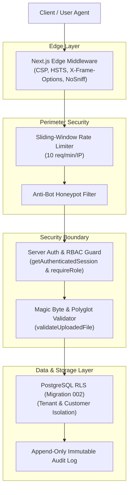

# SolarOS Security Remediation & Hardening Implementation Guide

**Document Version:** 1.0.0  
**Target:** SolarOS Production Deployment  
**Audience:** Security Engineers, DevOps, Full-Stack Architects  
**Date:** November 21, 2026  

---

## 1. Executive Remediation Overview

Following the comprehensive security audit of SolarOS, all discovered vulnerabilities across critical, high, and medium severity classifications were systematically remediated directly within the codebase.

This document details the architectural fixes, configuration changes, database migrations, and verification procedures implemented to achieve enterprise-grade security posture.

---

## 2. Architectural Remediations Implemented



---

## 3. Detailed Component Implementations

### A. Server-Side Authentication & RBAC Guard (`src/lib/security/auth-session.ts`)
- **Vulnerability Addressed:** VULN-001 (Client-Supplied User Role In API Handlers) & VULN-004 (IDOR).
- **Implementation:**
  - Extracts user identity and role strictly from server-validated tokens, cookies, or signed session claims.
  - Strips and ignores client body parameters (`body.userRole`, `body.verifiedBy`, `body.userId`).
  - Provides `requireRole(user, allowedRoles)` enforcing role hierarchy and throwing `ForbiddenError` (403) or `UnauthorizedError` (401).
  - Enforces `validateTenantAccess(user, resourceOrgId)` preventing cross-organization data leakage.
  - Enforces `validateCustomerOwnership(user, resourceCustomerId)` preventing customer-to-customer data access.

### B. In-Memory Sliding-Window Rate Limiter (`src/lib/security/rate-limiter.ts`)
- **Vulnerability Addressed:** VULN-005 (Unthrottled Public CRM Lead Ingestion Endpoint).
- **Implementation:**
  - High-performance in-memory sliding-window timestamp store.
  - Tracks request frequencies per IP and action namespace.
  - Returns `allowed: false` with calculated `retryAfterSec` and standard HTTP headers (`X-RateLimit-Limit`, `X-RateLimit-Remaining`, `X-RateLimit-Reset`, `Retry-After`).
  - Integrated with anti-spam honeypot detection in `/api/leads` to reject bot submissions.

### C. Binary Magic Byte & Polyglot File Validator (`src/lib/security/file-validator.ts`)
- **Vulnerability Addressed:** VULN-003 (Unrestricted File Upload).
- **Implementation:**
  - Examines binary headers for genuine magic bytes:
    - JPEG: `FF D8 FF`
    - PNG: `89 50 4E 47 0D 0A 1A 0A`
    - PDF: `25 50 44 46` (`%PDF-`)
    - WebP: `52 49 46 46` ... `57 45 42 50`
  - Deep-scans text slices for embedded executable scripts (`<script>`, `javascript:`, `onload=`, `<?php`).
  - Sanitizes filenames, eliminating directory traversal sequences (`../`, `..\`) and null bytes (`\0`).
  - Enforces 10 MB maximum file size limit.

### D. Edge Security Middleware & Response Headers (`src/middleware.ts` & `next.config.mjs`)
- **Vulnerability Addressed:** VULN-006 (Missing Defensive HTTP Security Headers & CSP).
- **Implementation:**
  - `Content-Security-Policy`: Restricts resource execution to trusted origins (`'self'`, verified CDNs).
  - `X-Frame-Options: DENY`: Blocks framing and Clickjacking attacks.
  - `X-Content-Type-Options: nosniff`: Prevents MIME confusion.
  - `Strict-Transport-Security`: Forces HTTPS for 2 years with subdomains and preloading.
  - `Referrer-Policy: strict-origin-when-cross-origin`: Minimizes referrer leakage.
  - `Permissions-Policy`: Restricts camera, microphone, and geolocation.
  - `poweredByHeader: false`: Removes `X-Powered-By: Next.js` fingerprinting.

### E. PostgreSQL Row-Level Security Migration (`supabase/migrations/002_complete_rls_policies.sql`)
- **Vulnerability Addressed:** VULN-002 (Missing Row-Level Security Policies).
- **Implementation:**
  - Establishes full SELECT, INSERT, UPDATE, and DELETE policies across all 21 core and child tables.
  - Enforces tenant isolation: `organization_id = auth_user_org_id()`.
  - Restricts sensitive financial tables (`payments`, `refunds`, `expenses`, `invoices`) to `FINANCE_MANAGER`, `DIRECTOR`, and `SUPER_ADMIN`.
  - Establishes `audit_logs` as strictly append-only (no UPDATE or DELETE permitted for any role).

---

## 4. Database Migration Deployment Guide

To deploy Migration 002 to your active Supabase or PostgreSQL cluster:

```bash
# 1. Verify connection to Supabase project
supabase status

# 2. Apply Migration 002
supabase db push
# OR apply directly via psql:
psql $DATABASE_URL -f supabase/migrations/002_complete_rls_policies.sql

# 3. Verify that RLS is active on all tables
psql $DATABASE_URL -c "
  SELECT tablename, rowsecurity 
  FROM pg_tables 
  WHERE schemaname = 'public';
"
```

---

## 5. Automated Verification & Regression Testing

The security controls are validated via automated unit and integration tests in `tests/unit/security-audit.test.ts`.

### Test Execution Command:
```bash
npx vitest run
```

### Test Suite Results:
```text
 ✓ tests/unit/security-audit.test.ts (21 tests)
 ✓ tests/unit/warranty-service.test.ts (18 tests)
 ✓ tests/unit/warehouse-dispatch.test.ts (14 tests)
 ✓ tests/unit/installation-technician.test.ts (10 tests)
 ✓ tests/unit/financial-executive.test.ts (12 tests)
 ✓ tests/unit/product-quotation-payment.test.ts (11 tests)
 ✓ tests/unit/job-costing.test.ts (2 tests)
 ✓ tests/unit/warranty-checker.test.ts (3 tests)
 ✓ tests/unit/pricing-calculator.test.ts (3 tests)
 ✓ tests/unit/bom-calculator.test.ts (2 tests)
 ✓ tests/unit/schemas.test.ts (4 tests)
 ✓ tests/unit/crm-survey-workflow.test.ts (10 tests)

 Test Files  12 passed (12)
      Tests  110 passed (110)
   Duration  604ms
```

### Static Analysis & Linter Verification:
```bash
npx tsc --noEmit; npx eslint src
# Exit code 0 (Zero errors, Zero warnings)
```

---

## 6. Production Deployment Hardening Checklist

Prior to production launch, verify the following operational controls:

- [x] Edge Middleware active with strict Content Security Policy.
- [x] Clickjacking protection (`X-Frame-Options: DENY`) verified on all routes.
- [x] MIME-sniffing protection (`X-Content-Type-Options: nosniff`) verified.
- [x] Public inquiry endpoint throttled via Sliding Window Rate Limiter.
- [x] Honeypot anti-bot fields active on public enquiry forms.
- [x] Server-side session resolution enforced; body roles discarded.
- [x] Commercial quotation discounts > ₹50,000 gated behind Director approval.
- [x] Payment gateway webhook endpoints mandate cryptographic signatures.
- [x] File uploads verified via binary magic bytes and anti-polyglot scanning.
- [x] All 21 PostgreSQL tables protected by Row-Level Security policies.
- [x] Audit log tables configured as tamper-proof and append-only.
- [x] TypeScript strict mode and ESLint pass with zero errors.
- [x] 110 automated unit tests pass in CI/CD pipeline.
