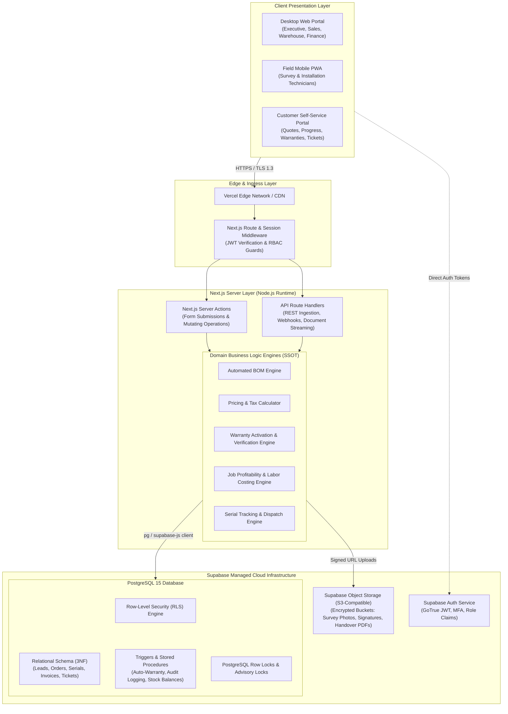
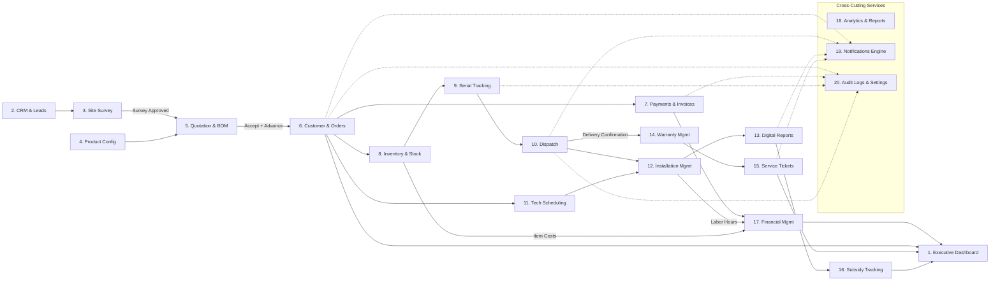
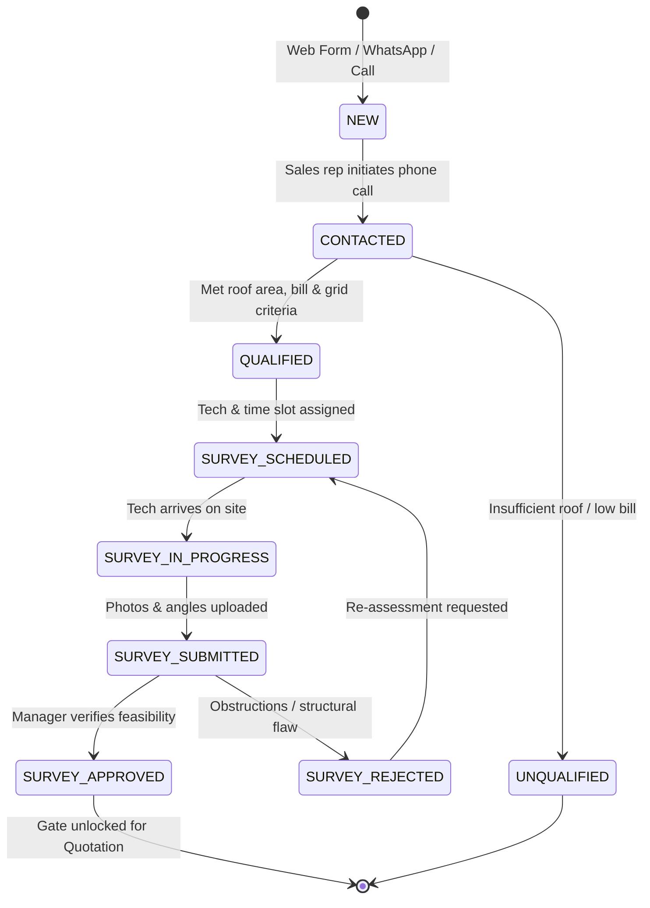
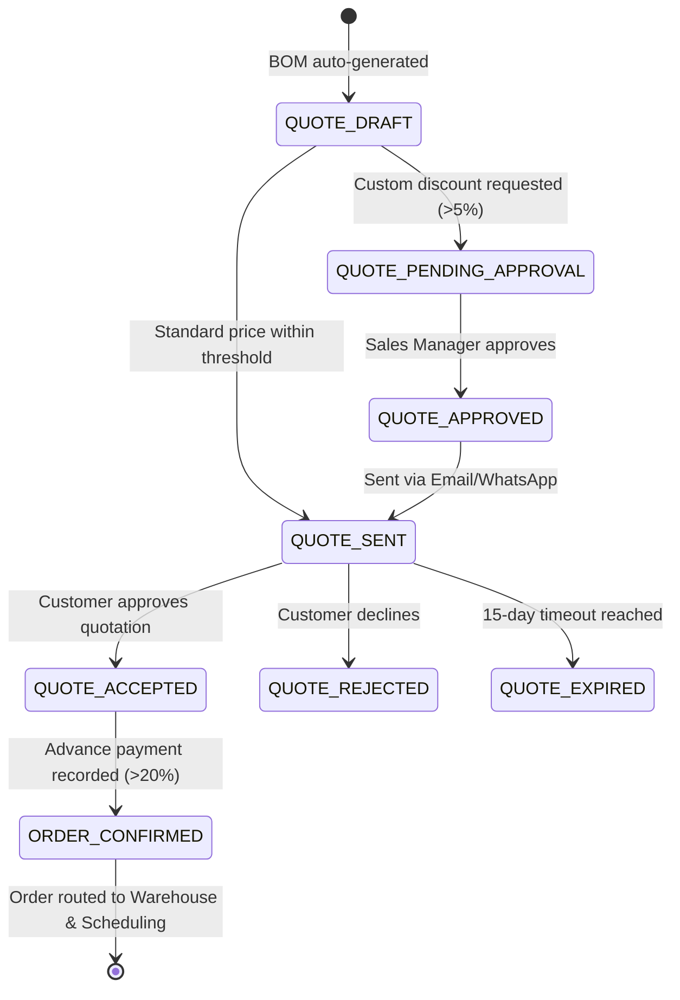
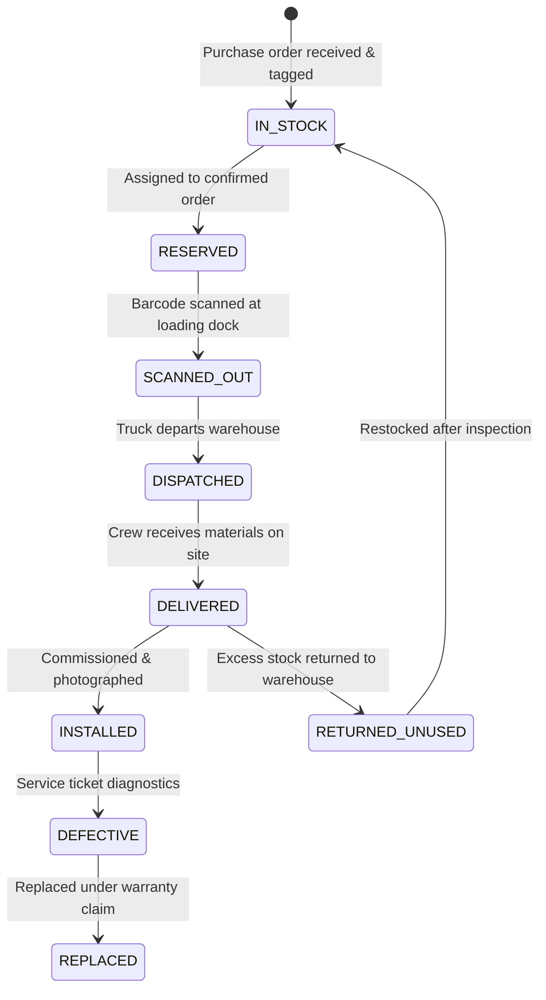
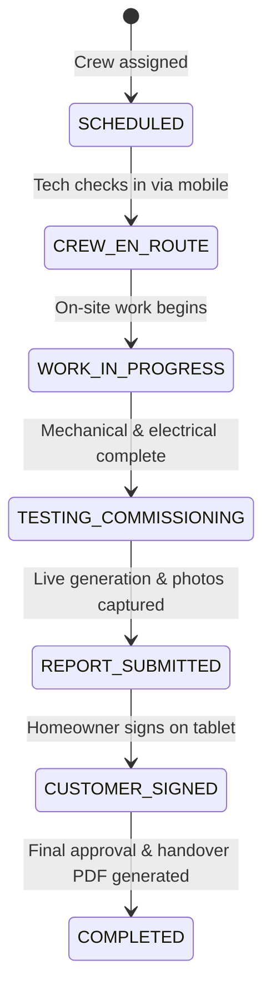
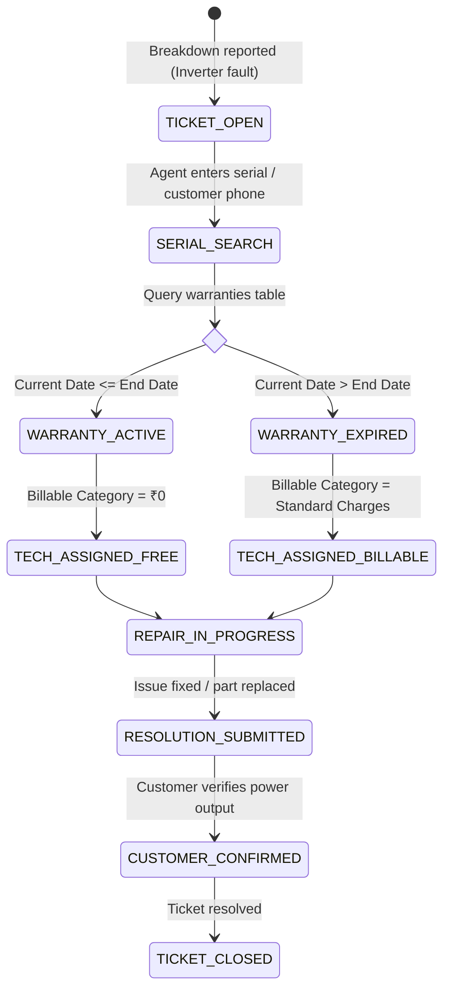
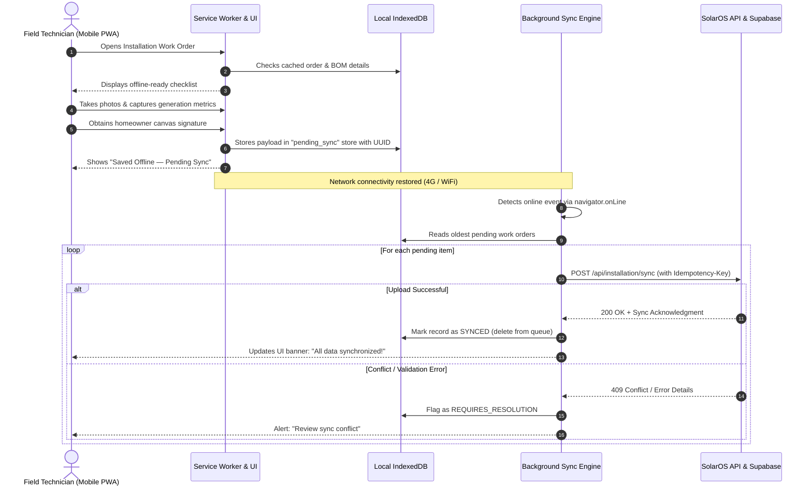

# SolarOS: System Architecture & Technical Design Specification
**System:** SolarOS — The Complete Solar Business Operating System  
**Framework:** Next.js (App Router) + TypeScript + Supabase PostgreSQL + Supabase Storage  
**Author:** Principal Software Architect & Cybersecurity Lead  
**Status:** Approved Architectural Baseline  

---

## 1. Architectural Philosophy & Core Tenets

SolarOS is designed as a mission-critical, enterprise-grade operating system for distributed rooftop solar operations. Its architecture is guided by six non-negotiable principles:

1. **Single Source of Truth (SSOT):** Business calculations (such as Bill of Materials generation, quotation pricing, warranty eligibility, and job profitability) reside strictly in single-purpose domain service modules. The frontend never computes prices, taxes, or BOM quantities; it merely displays server-validated state.
2. **ACID Transaction Boundaries:** Critical operations that bridge multiple entities (e.g., dispatching serialized inventory, confirming advance payments, converting quotes to orders) execute within atomic PostgreSQL transactions (`BEGIN...COMMIT`) or transactional RPCs. Failure at any sub-step rolls back the entire operation.
3. **Defense-in-Depth Security:** Authorization is enforced at three distinct layers:
   * Presentation: UI components trimmed via role capabilities.
   * Application Server: Next.js Server Actions and Route Handlers validated via authenticated session tokens and Zod schemas.
   * Database: Supabase PostgreSQL Row-Level Security (RLS) policies guaranteeing data isolation even if an application-level guard is bypassed.
4. **Idempotency by Design:** All mutating operations (order generation, barcode dispatch scans, payment captures) require unique idempotency keys or database-level uniqueness constraints to prevent duplicate processing from network retries or double clicks.
5. **Offline-Resilient Field Operations:** Mobile forms used by on-site technicians (site surveys and installation reports) cache data locally in browser IndexedDB, enabling uninterrupted data capture and photo staging in remote rooftop areas with poor cellular reception.
6. **Immutable Auditability:** System state changes are recorded in an append-only audit trail that logs the initiating user, timestamp, prior state, new state, and IP address.

---

## 2. High-Level System Architecture



---

## 3. Layered Application Structure

The application codebase follows a clean, decoupled 5-tier architecture:

```
src/
├── app/                          # Next.js App Router (Routing & Presentation)
│   ├── (auth)/                   # Authentication flows (Login, Password Reset)
│   ├── (dashboard)/              # Role-specific operational interfaces
│   │   ├── executive/            # Executive KPI Dashboard & Profitability Heatmap
│   │   ├── sales/                # Leads, Surveys, Quotation Builder
│   │   ├── warehouse/            # Inventory, Serial Scanning, Dispatch
│   │   ├── field/                # Mobile-first Survey & Installation Wizards
│   │   ├── finance/              # Payments, Invoices, Subsidies, Job Costing
│   │   └── tickets/              # Service Tickets & Warranty Search
│   ├── (portal)/                 # Customer Self-Service Portal
│   └── api/                      # REST Route Handlers (Webhooks, File Exports)
│
├── components/                   # Reusable UI Components
│   ├── ui/                       # shadcn/ui primitives (Button, Dialog, Form, Card)
│   ├── shared/                   # Composite widgets (StatusPill, SignatureCanvas, PhotoUploader)
│   └── tables/                   # Data tables with filtering, sorting, and pagination
│
├── domain/                       # Core Business Logic Engines (Pure TypeScript, Zero Side-Effects)
│   ├── bom/                      # Capacity to BOM mapping formulas
│   ├── pricing/                  # Price calculations, GST bifurcations, subsidy deduction
│   ├── warranty/                 # Warranty duration resolution and validity checkers
│   ├── costing/                  # Job profitability and gross margin formulas
│   └── state-machines/           # Formal transition definitions and transition guards
│
├── server/                       # Server-Side Orchestration (Server Actions & DAL)
│   ├── actions/                  # Next.js Server Actions with Zod validation & auth guards
│   ├── db/                       # Supabase admin client and raw SQL transaction utilities
│   └── storage/                  # Supabase storage helpers (Presigned URL generators)
│
├── lib/                          # Shared cross-cutting utilities
│   ├── schemas/                  # Zod validation schemas (shared between client & server)
│   ├── types/                    # TypeScript interfaces and database type definitions
│   └── utils/                    # Formatting (currency, date, serial formatting)
```

---

## 4. Module Dependency Graph

The 20 modules interact under strict directional rules to prevent circular dependencies. Operations flow logically from Customer Intake $\to$ Engineering $\to$ Commerce $\to$ Logistics $\to$ Construction $\to$ Support $\to$ Finance:



---

## 5. Business State Machines & Transition Guards

### 5.1 Lead & Survey Lifecycle State Machine

* **Guard Condition (Critical Gate):** The transition to Quotation Generation (`QUOTATION_DRAFT`) cannot execute unless `leads.survey_status == 'APPROVED'`.

### 5.2 Quotation & Order Lifecycle

* **Guard Condition:** An Order cannot be placed in `CONFIRMED` status without either:
  1. A verified payment transaction covering $\ge$ default advance percentage, OR
  2. A director-level credit override logged with justification in audit logs.

### 5.3 Warehouse Dispatch & Serial Number Lifecycle

* **Critical Automated Trigger:** The transition of Dispatch to `DELIVERED` automatically inserts records into the `warranties` table for all associated serial numbers with:
  * `warranty_start_date = CURRENT_DATE`
  * `warranty_end_date = CURRENT_DATE + interval (sku.warranty_months)`

### 5.4 Installation & Commissioning Lifecycle

* **Guard Condition:** Transition to `COMPLETED` requires all 5 mandatory installation photos to be uploaded and a valid touch-signature vector in the handover record.

### 5.5 Service Ticket & Warranty Decision Engine


---

## 6. Offline-First Mobile Synchronization Architecture

Field technicians frequently operate on reinforced concrete rooftops or rural fringe areas with zero cell reception. The SolarOS Field Progressive Web App (PWA) implements a local-first offline synchronization pattern:



### Photo Compression Pipeline Before Staging:
To prevent upload timeouts and preserve technician mobile bandwidth:
1. Photos captured via `<input type="file" capture="environment">` are intercepted by an in-browser HTML5 `<canvas>` compressor.
2. The image is resized to a maximum dimension of $1920 \times 1080$ pixels at 82% JPEG quality.
3. Metadata watermarking: The script draws a semi-transparent timestamp and GPS coordinate block onto the bottom-right corner of the canvas.
4. The resulting Blob ($\approx 350 \text{ KB}$ vs $4.5 \text{ MB}$ raw) is stored in IndexedDB as a binary record ready for background streaming.

---

## 7. Concurrency Control & Idempotency Safeguards

In high-throughput operations, duplicate orders or simultaneous double-dispatch of the same serial number create devastating warehouse inventory mismatches. SolarOS mitigates this using two explicit patterns:

### 7.1 Database Advisory Locks for Dispatch Operations
When a warehouse manager executes a dispatch operation, the system acquires an exclusive transaction-scoped advisory lock derived from the order ID:

```sql
-- Acquire transaction-level advisory lock
SELECT pg_advisory_xact_lock(hashtext('dispatch_' || p_order_id::text));

-- Inside this protected transaction block:
-- 1. Verify order status is still 'READY_FOR_DISPATCH'
-- 2. Validate all scanned serial numbers are currently 'IN_STOCK'
-- 3. Update serial statuses to 'DISPATCHED'
-- 4. Decrement warehouse stock balances
-- 5. Create dispatch consignment record
-- The lock is automatically released upon COMMIT or ROLLBACK.
```

### 7.2 Unique Hardware Assignment Constraints
A single physical inverter cannot exist on two roofs simultaneously. This invariant is enforced at the database layer via partial unique indexes:

```sql
-- Ensure an active serial number cannot be assigned to more than one active order
CREATE UNIQUE INDEX idx_unique_active_serial_assignment 
ON order_serial_assignments (serial_number_id) 
WHERE status IN ('RESERVED', 'DISPATCHED', 'INSTALLED');
```
Attempts to assign or dispatch an already-dispatched serial number are rejected instantly by the PostgreSQL engine with a constraint violation error (`23505`), completely eliminating race conditions.
